# ArcMD Web Clipper

Official Chrome / Edge / Arc / Brave browser extension for [ArcMD](https://github.com/Ciao1019/ArcMD) — clip clean Markdown articles, web highlights, anti-hotlink images, and structured records directly into your local ArcMD Spaces and `.db.md` Databases via Chrome **Native Messaging** (zero open HTTP ports, zero cloud relay, works even when ArcMD is closed).



## Features

- **Native Messaging Direct Sync (Live + Headless)**
  - Connects directly to your local `ArcMD` binary via `com.cizai.arcmd.clipper`.
  - Live syncs instantly into an open ArcMD window over loopback IPC, and seamlessly writes straight to disk in headless mode when ArcMD is closed.
- **4 Clip Modes & Site Adapters**
  - **Article** (Mozilla Readability + dedicated adapters for WeChat `mp.weixin.qq.com`, Zhihu `zhihu.com`, and GitHub)
  - **Selection**, **Bookmark**, and **Highlights-only**
  - Clean ArcMD Markdown output preserving GFM tables, fenced code languages, task lists, KaTeX/TeX formulas, `<mark>` highlights, and `<details>`.
- **Shadow DOM Web Highlighter**
  - Highlight any webpage with 4 colors + inline notes (`Alt+Shift+H` or popup toggle).
  - Highlights persist per normalized URL in `chrome.storage.local` and restore automatically on reload.
- **Anti-Hotlink Image Localization**
  - Downloads images in browser context with cookies/auth (`mmbiz.qpic.cn`, Zhihu, private wikis), validates magic bytes in ArcMD, stores them atomically in `assets/` or your Space's attachments folder, and rewrites Markdown & cover URLs automatically.
- **4 Save Targets**
  - **New Note** (Space, Folder, ArcMD Space Template, Pin/Favorite)
  - **Daily Note** (append bottom / insert top)
  - **Append to Existing Note**
  - **ArcMD Multi-dimensional Database (`.db.md`)** with dynamically rendered typed property fields (`select`, `multi_select`, `url`, `date`, `number`, `checkbox`, `text`).
- **Custom Templates, URL Triggers & Duplicate Detection**
  - Domain / prefix / regex auto-matching templates with chained filters (`trim`, `slice`, `date`, `wikilink`, `blockquote`, `replace`, `join`) and JSON import/export.
  - Real-time URL deduplication across all Spaces and `.db.md` databases.
- **Local AI Summary & Tags**
  - Reuses your existing ArcMD AI provider & credentials — no second API key setup in the browser.

## Quick Setup

1. Build or download the extension:
   ```sh
   npm install
   npm run build
   ```
2. Open `chrome://extensions` (or `edge://extensions`), enable **Developer Mode**, and click **Load unpacked** → select the `dist/` folder.
   - Thanks to the pinned MV3 manifest `key`, unpacked installs automatically receive the deterministic Extension ID `njbinggncmencnnnhcccpamjiolhglen`.
3. Open **ArcMD** → **Settings › AI › 浏览器剪藏 (Web Clipper)** → click **「一键安装连接」** (or run `arcmd clipper install` in your terminal).
4. Click the ArcMD Clipper icon (or press `Alt+Shift+C`) on any webpage and start clipping!

## Development

```sh
npm run dev        # Watch & rebuild dist/
npm run typecheck  # TypeScript strict check
npm test           # Vitest unit tests
npm run zip        # Build release/arcmd-clipper-v*.zip
```

## License

MIT
